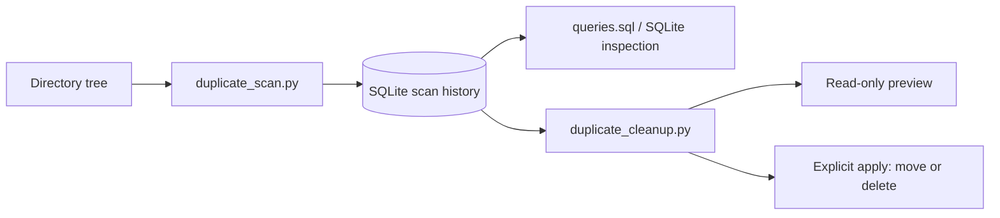

# Duplicate File Scanner & Cleanup Toolkit

Find identical files regardless of their names, inspect the results in SQLite,
and separately preview or apply cleanup. This standard-library Python toolkit
pairs a filesystem inventory with conservative, independently controlled file
retention and cleanup decisions.

## Capabilities

- Recursive traversal with symbolic links and multiply linked files excluded.
- Complete-file SHA-256 comparison, with size filtering before hashing.
- SQLite scan history, deterministic duplicate groups, and inspection queries.
- Alphabetical or newest-modified retention for either move or delete.
- Read-only previews, explicit application, and content revalidation.
- Recoverable quarantine paths and persisted operation intent.
- Automated tests using isolated temporary directories.

Detection and cleanup are separate programs so an inventory can be reviewed
before any file is selected for removal.

## Architecture



`duplicate_scan.py` records regular files in batches, selects repeated sizes,
hashes candidates, and assigns groups by size plus SHA-256. Group identifiers
are scoped to a scan. `duplicate_cleanup.py` loads the latest completed scan
unless `--scan-id` selects another, verifies pending group members, chooses a
keeper, and previews or performs the requested action.

## Installation

Linux Mint 22 / Linux, Python 3.10 or newer. No third-party Python packages
are required. The optional SQLite client is useful for inspection:

```bash
sudo apt update
sudo apt install python3 sqlite3 git
git clone https://github.com/dave-adam-aparicio/duplicate-file-scanner.git
cd duplicate-file-scanner
python3 --version
```

The clone URL becomes available after repository publication. Run directly;
a package installation or virtual environment is unnecessary.

## Try it with disposable example data

```bash
DEMO_DIR=$(mktemp -d)
mkdir -p "$DEMO_DIR/input/one" "$DEMO_DIR/input/two"
printf 'identical content\n' > "$DEMO_DIR/input/one/a.txt"
cp "$DEMO_DIR/input/one/a.txt" "$DEMO_DIR/input/two/b.txt"
python3 duplicate_scan.py "$DEMO_DIR/input" --database "$DEMO_DIR/inventory.db"
sqlite3 "$DEMO_DIR/inventory.db" < queries.sql
python3 duplicate_cleanup.py "$DEMO_DIR/inventory.db"
python3 duplicate_cleanup.py "$DEMO_DIR/inventory.db" --keep newest --move "$DEMO_DIR/quarantine"
```

The last two commands preview only. Keep database inventories private: they
contain absolute paths and file metadata.

## Command reference

Scanner:

```text
python3 duplicate_scan.py ROOT [--database PATH | -d PATH] [--verbose | -v]
```

`ROOT` is scanned recursively. The database defaults to `duplicates.db`.
Every invocation adds a scan without discarding previous results. The database
and its SQLite journal files are excluded when stored within the scanned tree.
Unreadable directories/files are reported; errors produce a nonzero exit code.

Cleanup:

```text
python3 duplicate_cleanup.py DATABASE [--scan-id ID]
    [--keep {alphabetical,newest}] [--move DIR | --delete]
    [--apply] [--verbose | -v]
```

- `DATABASE`: existing scanner database; missing databases are not created.
- `--scan-id`: completed scan to inspect, default latest completed scan.
- `--keep`: retention policy, default `alphabetical`.
- `--move DIR`: quarantine destination outside the scanned tree. It must also
  not contain the scan root; symlink components are rejected.
- `--delete`: select permanent deletion. Without an action, preview deletion.
- `--apply`: actually perform the explicitly selected move or delete action.
- `--verbose`, `-v`: enable debug logging in either program.

Each preview reports the scan/group identifier, policy, keeper, candidate
paths, sizes, nanosecond modification timestamps, action, destination if
applicable, total selected files and logical bytes. Failures return nonzero.

### Retention policies

`--keep alphabetical` retains the smallest full absolute path in ascending,
case-sensitive order. This preserves the original SQLite BINARY ordering for
normal filesystem Unicode paths; it is not locale-aware or natural sorting.

`--keep newest` retains the file with the greatest **current filesystem
`st_mtime_ns`**. Equal timestamps resolve to the alphabetically first full path.
Creation time, database insertion time, and filenames do not determine age.
A timestamp change after scanning is permitted if content still matches.
Filesystem timestamp resolution can be coarser than nanoseconds.

The retained file is chosen independently of move or delete:

```bash
# Preview first, for either policy and action
python3 duplicate_cleanup.py inventory.db --keep alphabetical --move /path/to/quarantine
python3 duplicate_cleanup.py inventory.db --keep newest --move /path/to/quarantine
python3 duplicate_cleanup.py inventory.db --keep alphabetical --delete
python3 duplicate_cleanup.py inventory.db --keep newest --delete

# Apply one reviewed operation; these examples are alternatives
python3 duplicate_cleanup.py inventory.db --keep alphabetical --move /path/to/quarantine --apply
python3 duplicate_cleanup.py inventory.db --keep newest --move /path/to/quarantine --apply
python3 duplicate_cleanup.py inventory.db --keep alphabetical --delete --apply
python3 duplicate_cleanup.py inventory.db --keep newest --delete --apply
```

`--delete --apply` is the explicit permanent-deletion confirmation. There is no
interactive prompt. Start with quarantine and review its contents before any
later manual disposal.

## Safety and recovery

Preview uses a read-only database connection and does not create destination
directories or update cleanup status. Applying cleanup rehashes **all** pending
group members, including the keeper. Missing, renamed, changed, inaccessible,
symlinked or multiply linked members cause the group to be skipped. The keeper
and candidate are revalidated immediately before each unlink. A failed operation
stops further actions within that group.

Quarantine uses `DIR/scan-ID/relative/source/path` to separate identical
basenames. Exclusive creation prevents overwriting an existing destination;
collisions are reported and skipped. Copies are streamed, flushed, synced and
verified before source removal, including across filesystems. Source and target
mapping is committed to `files.action_note` before mutation. Successful actions
record `moved` or `deleted`; retained rows remain `pending`.

If interrupted, inspect `action_note`, the source, and destination before retrying.
An interrupted copy may remain partial and an interrupted completed move may
leave a pending row with a missing source. Existing targets are never overwritten
or automatically discarded. Keep the database alongside quarantine for recovery.
Repeated runs verify remaining pending members and never act on a lone copy.

Use trusted, idle local directories and backups. Portable pathname operations
cannot eliminate the final race between verification and unlink; this is not a
security boundary against hostile users or concurrent writers. Do not run
concurrent cleanup processes. Ownership, ACLs and extended attributes are not
preserved by copies; mode and modification time are copied where supported.
Hard links are excluded rather than presented as independent recoverable storage.
Historical databases containing them are conservatively skipped during cleanup.

## SQLite inspection and compatibility

```bash
sqlite3 inventory.db
```

Inside the client:

```sql
.headers on
.mode column
.read queries.sql
SELECT path, size, modified_time, status
FROM files WHERE scan_id = 1 AND duplicate_group = 1 ORDER BY path;
```

`scans` contains roots, UTC start/completion times, file/hash/group counts and
error totals. `files` contains scan membership, path/name, size, SHA-256,
`modified_time` (historical Unix seconds as REAL), duplicate group, status,
action timestamps/notes, scan timestamp and error message. Only repeated-size
candidates have hashes; unique-size files remain inventoried without a hash.
`duplicate_files` counts all group members, including keepers.

`queries.sql` lists scans, groups, paths, sizes, modification times, cleanup
status, operation mappings and potential logical savings. Estimates are per
scan and must not be summed across overlapping inventories. Physical savings
can differ due to sparse files, compression, snapshots or filesystem behavior.

The original schema is retained; no migration or data deletion is required.
Newest retention reads live nanosecond timestamps, avoiding the precision limits
of historical REAL timestamps. Unknown/incomplete schemas fail with guidance:
preserve the old database and rescan into a new database. No automatic migration
of arbitrary third-party formats is attempted.

## Tests

```bash
python3 -m unittest discover -s tests -v
```

Tests create disposable temporary trees and databases. They cover content
comparison, both retention policies and timestamp ties, all retention/action
combinations, unchanged dry-runs, missing/changed files, a disappearing keeper,
collisions, duplicate basenames, unsafe destinations, scan isolation, repeated
cleanup, symlink/hard-link policy, original-schema compatibility, and incompatible
schema diagnostics. No personal files are cleanup test targets.

## Engineering considerations

SHA-256 reads complete candidate files in 1 MiB chunks, keeping file-content
memory bounded. Size filtering avoids hashing files that cannot have duplicates.
Candidate path/group collections still consume memory proportional to inventory
size; this is not a constant-memory inventory engine. Hash collisions are
extremely unlikely but byte-for-byte pairwise comparison is not implemented.
Stable metadata checks bracket hashes to reject observable concurrent mutation.
SQLite parameterized statements and per-action commits support traceability;
filesystem operations and SQL cannot form a single atomic transaction.

The project demonstrates Python, SQLite, recursive filesystem traversal,
cryptographic hashing, file metadata inspection, safe file management, CLI
development, defensive programming and automated testing. It intentionally
avoids external dependencies, a plugin framework, GUI and parallel hashing.

See [review and design notes](docs/design.md) for findings and tradeoffs.

## License

[MIT](LICENSE).
